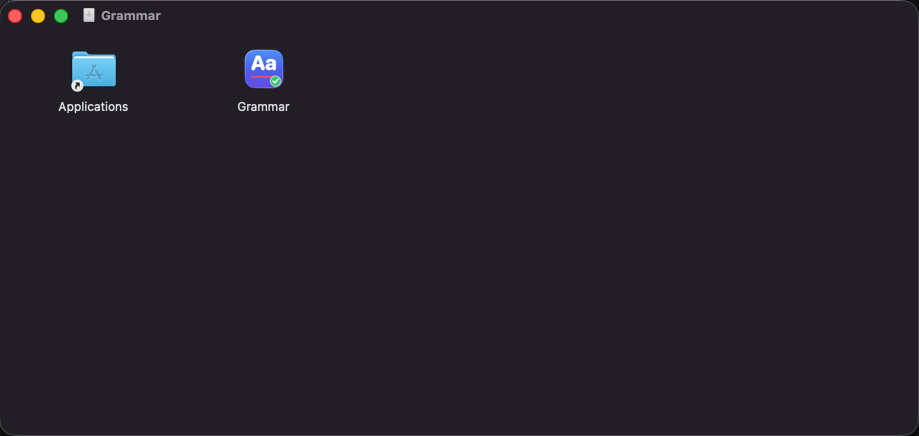
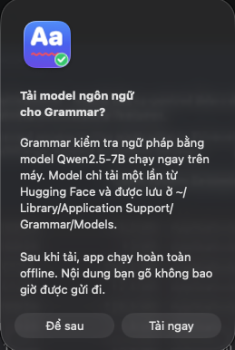
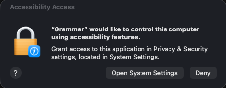
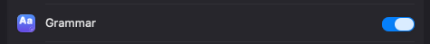

# Grammar

App menu bar cho macOS, kiểm tra ngữ pháp tiếng Anh **offline**. App đọc câu bạn đang gõ ở bất kỳ app nào (Slack, Teams, Chrome…) và hiện kết quả trên một panel nổi:

- **Phần trên:** câu bạn đang gõ, cụm sai được gạch chân đỏ.
- **Phần dưới:** câu đã sửa, phần sửa tô xanh. Bấm **⌃⌥C** để copy.
- **Bản dịch** (tuỳ chọn): bản dịch tiếng Việt, bật trong Cài đặt.

App chỉ sửa ngữ pháp, chính tả và dấu câu, và **không bao giờ ghi vào app bạn đang gõ**. Model (Qwen2.5-7B-Instruct) chạy ngay trên máy. Nội dung bạn gõ không bị gửi ra ngoài.

> Bản Windows: xem [windows/README.md](windows/README.md).

## Download

**[⬇ Tải Grammar-1.0.dmg](https://github.com/tq-bao/grammar/releases/latest/download/Grammar-1.0.dmg)** (khoảng 10 MB, macOS, Apple Silicon)

File cài không chứa model. App tải model (một lần) ở lần mở đầu tiên. Các phiên bản khác xem ở trang [Releases](https://github.com/tq-bao/grammar/releases).

## Cài đặt

Cần Mac Apple Silicon, macOS 26 trở lên, nên có 16 GB RAM và khoảng 5 GB ổ đĩa trống.

**1. Kéo Grammar vào Applications.** Mở file `Grammar-<version>.dmg`, kéo **Grammar** vào **Applications**, rồi mở app từ Applications.

<p align="center"></p>

> Nếu macOS báo không mở được vì không xác định được nhà phát triển: chuột phải vào Grammar › **Open** › **Open**.

**2. Tải model.** Lần đầu mở app, chọn **Tải ngay**. Model chỉ tải một lần, sau đó app chạy hoàn toàn offline. Nếu chọn **Để sau**, lúc nào muốn tải thì vào menu bar › **Tải model…**.

<p align="center"></p>

**3. Cấp quyền Accessibility.** App cần quyền này để đọc ô bạn đang gõ. Chọn **Open System Settings** khi được hỏi (hoặc menu bar › **Cấp quyền Accessibility…**):

<p align="center"></p>

Rồi bật **Grammar** trong Privacy & Security › Accessibility. App tự chạy sau khoảng 1 giây.

<p align="center"></p>

> Đã bật mà panel vẫn báo thiếu quyền: xoá mục Grammar trong danh sách (nút **−**) rồi thêm lại `/Applications/Grammar.app` (nút **+**).

## Cách dùng

| Thao tác | Kết quả |
|---|---|
| Gõ tiếng Anh rồi dừng khoảng 0.7 giây | Kiểm tra câu đang chứa con trỏ |
| Bôi đen một từ hoặc một đoạn | Kiểm tra đúng đoạn bôi đen |
| Bôi đen rồi bấm **⌃⌥G** | Kiểm tra đoạn bôi đen, dùng cho app không đọc được ô nhập |
| **⌃⌥C** | Copy câu đã sửa |
| Menu bar › **Cài đặt…** | Độ mờ nền, góc màn hình, độ rộng panel, click xuyên qua, Dịch |

Panel chỉ để xem, click sẽ đi xuyên xuống app phía sau. Muốn dời panel thì kéo dải header ở trên cùng.

**Giới hạn:** chỉ kiểm tra một câu (câu chứa con trỏ) trừ khi bôi đen. Bỏ qua câu dưới 3 từ, câu không phải tiếng Anh và ô mật khẩu. Một số app không đọc được ô nhập ([danh sách](docs/app-compatibility.md)), khi đó dùng ⌃⌥G. Model vẫn có thể bỏ sót hoặc sửa hơi quá tay ([số liệu](docs/model-benchmark.md)).

**Model** nằm ở `~/Library/Application Support/Grammar/Models/`. Xoá thư mục này để xoá model. Nếu mạng chặn Hugging Face, tải [file model](https://huggingface.co/bartowski/Qwen2.5-7B-Instruct-GGUF/blob/main/Qwen2.5-7B-Instruct-Q4_K_M.gguf) bằng cách khác rồi đặt vào thư mục này.

## Phát triển

Cần Xcode 27 và [XcodeGen](https://github.com/yonaskolb/XcodeGen) (`brew install xcodegen`).

```bash
./scripts/fetch-llama.sh            # tải llama.xcframework vào Vendor/
./scripts/download-model.sh bartowski/Qwen2.5-7B-Instruct-GGUF Qwen2.5-7B-Instruct-Q4_K_M.gguf
                                    # model cho test/benchmark, vào GrammarApp/Resources/Models/

./scripts/create-signing-cert.sh    # một lần: chứng chỉ ký để giữ quyền Accessibility qua các lần cài
./scripts/install.sh                # build Release, cài vào /Applications, mở app
./scripts/make-dmg.sh               # tạo dist/Grammar-<version>.dmg

xcodebuild -project GrammarApp.xcodeproj -scheme GrammarApp -derivedDataPath build test
```

Cấu trúc:

```
GrammarKit/       logic: Diff, Panel, Pipeline, Engine (llama.cpp, tìm và tải model)
GrammarApp/       app: menu bar, quyền, đọc ô nhập, panel
GrammarAppTests/  unit test + golden set
GrammarBench/     benchmark model
windows/          bản Windows (C#)
```

- **Đổi model:** sửa tên file, URL, SHA256 và kích thước trong `GrammarKit/Engine/ModelLocator.swift`. Khi dev có thể trỏ tới file khác bằng biến môi trường `GRAMMAR_MODEL_PATH`.
- **Sửa logic dùng chung** (prompt, EditGuard, diff, bộ lọc ngôn ngữ) thì phải sửa cả bản C# trong `windows/src/Grammar.Core/`, rồi chạy `dotnet test windows/Grammar.sln`.
- **App không đọc đúng câu đang gõ:** chạy `swift scripts/ax-probe.swift <bundle-id>` để xem app đó trả về gì qua Accessibility.
